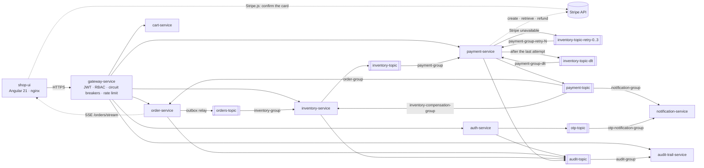
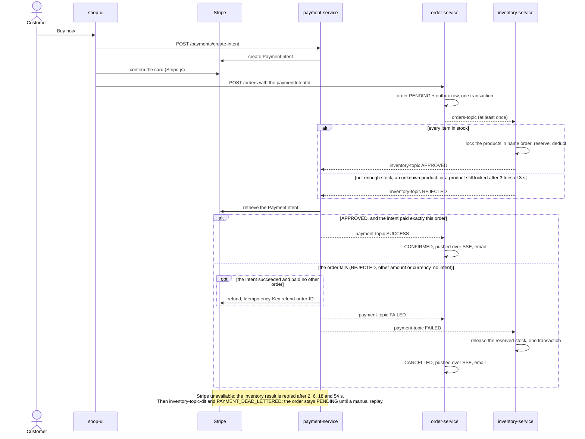
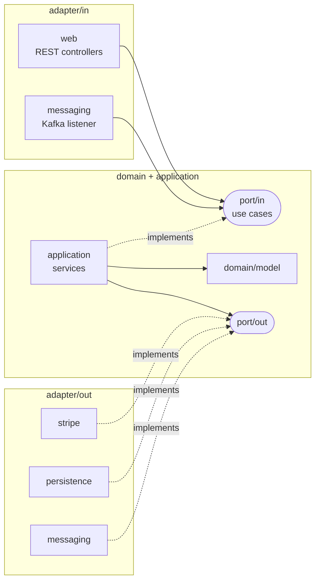

# Online Shop — Microservices Platform

[%3D%27project%27%5D%2F*%5Blocal-name()%3D%27version%27%5D&label=version)](CHANGELOG.md)
[](https://github.com/daniellaera/spring-microservices-saga/tags)
[](https://github.com/daniellaera/spring-microservices-saga/commits/main)
[](https://github.com/daniellaera/spring-microservices-saga)
[%3D%27java.version%27%5D&label=Java&color=blue)](pom.xml)
[%3D%27spring-boot.version%27%5D&label=Spring%20Boot&color=green)](pom.xml)
[](shop-ui/package.json)

<!-- Every badge is read live by shields.io from the public GitHub mirror (the Gitea instance is LAN-only).
     Test count and coverage come from CI (pr.yml, coverage gate 90 %) and are not shown as fixed numbers. -->

A production-grade microservices e-commerce platform built on Java 21 and Spring Boot 4, demonstrating enterprise patterns including event-driven saga choreography, transactional outbox, real-time SSE updates, JWT gateway authentication, and Stripe payment processing. Deployed on a self-hosted Proxmox homelab with Gitea Actions CI/CD and Infisical secrets management.

---

## Architecture



inventory-service and order-service retry their own failures the same way, on topics named after them:
`orders-topic-inventory-retry-N` / `-dlt`, `payment-topic-inventory-retry-N` / `-dlt` and
`payment-topic-order-retry-N` / `-dlt` (5 attempts, then the dead-letter topic, where the record is logged once).

Each stateful service owns its PostgreSQL database (authdb, orderdb, inventorydb, paymentdb, auditdb). Redis serves the
gateway rate limiter, the carts and the product list cache. config-server serves every service's configuration;
Grafana LGTM receives traces, metrics and logs over OTLP.

### Saga flow, with compensation

The saga is choreographed: no component runs it, each service reacts to the previous event
([ADR 13](docs/adr/0013-choreographed-saga.md)). The customer pays in the browser before the order exists, so a
failed order refunds a captured payment ([ADR 17](docs/adr/0017-payment-compensation-by-refund.md)).



Every step is idempotent, because every event can be delivered twice: inventory skips an order it already
reserved, payment-service records one transaction per order and republishes it, and an order changes status
only from PENDING.

### Hexagonal layout of a service

order-service, inventory-service and payment-service use ports and adapters
([ADR 15](docs/adr/0015-hexagonal-architecture.md)); `HexagonalArchitectureTest` (ArchUnit) enforces the
rules. payment-service:

```
payment-service/src/main/java/com/daniellaera/paymentservice/
├── domain/
│   ├── model/           PaymentTransaction, IntentVerification, PaymentRefund, exceptions (no framework)
│   └── port/
│       ├── in/          ProcessInventoryResultUseCase, CreatePaymentIntentUseCase, VerifyPaymentQuery, …
│       └── out/         PaymentGateway, TransactionRepository, PaymentResultPublisher, AuditTrail
├── application/         ProcessInventoryResultService, CreatePaymentIntentService, …   (use cases)
├── adapter/
│   ├── in/web/          StripePaymentController, PaymentController, DTOs
│   ├── in/messaging/    InventoryResultEventListener (@RetryableTopic, @DltHandler)
│   ├── out/stripe/      StripePaymentGateway                (the only code that uses com.stripe)
│   ├── out/persistence/ TransactionPersistenceAdapter, JPA entity and mapper
│   └── out/messaging/   KafkaPaymentResultPublisher, KafkaAuditTrail
└── config/              PaymentUseCaseConfig (a @Bean per use case), StripeConfig
```



The rules: `domain` depends on nothing but `java`; `application` only on the domain (plus SLF4J and
`@Transactional`); neither knows an adapter; inbound adapters call ports, never application classes; adapters
don't depend on each other.

---

## Tech Stack

### Backend
| Technology | Version | Usage |
|------------|---------|-------|
| Java | 21 | Virtual threads, records |
| Spring Boot | 4.0.2 | Core framework |
| Spring Cloud Gateway | 2025.1.1 | API gateway, routing, JWT, RBAC |
| Spring Cloud Config | 2025.1.1 | Centralized configuration |
| Spring Security | 7 | JWT authentication, RBAC |
| Resilience4j | latest | Circuit Breaker (CLOSED / OPEN / HALF_OPEN) |
| Apache Kafka | 4.2.0 | Event-driven saga (KRaft — no Zookeeper) |
| PostgreSQL | 17 | Database per service |
| Redis | 8 | Rate limiting, cart sessions, product cache |
| Refresh Token Rotation | — | 15-min access / 7-day refresh, rotated on every use |
| Email Availability Check | — | Real-time email availability check on registration |
| Flyway | 11 | Database migrations |
| Stripe SDK | latest | Test-mode PaymentIntent API |
| OpenTelemetry | latest | Distributed traces + metrics + logs |
| Grafana LGTM | latest | Tempo + Loki + Mimir in one container |
| Testcontainers | 1.21.4 | Integration tests — real PostgreSQL + Kafka |
| JaCoCo | latest | Aggregate coverage report across all services |

### Frontend
| Technology | Version | Usage |
|------------|---------|-------|
| Angular | 21 | Single-page application |
| PrimeNG | 21 | UI components (Aura theme) |
| Stripe Elements | latest | Embedded, PCI-compliant payment UI |
| Dark/Light Mode | — | Theme toggle (PrimeNG Aura) |
| Notification Panel | — | In-app notification panel with event history |

### Infrastructure
| Technology | Usage |
|------------|-------|
| Docker Compose | Local dev + prod profiles |
| Gitea Actions | CI/CD pipeline |
| Infisical (self-hosted) | Secrets management |
| Proxmox | Homelab deployment (infra-node1) |

---

## Services

| Service | Port | Description |
|---------|------|-------------|
| shop-ui | 80 | Angular 21 frontend — PrimeNG Aura UI |
| gateway-service | 8080 | Spring Cloud Gateway — JWT, rate limiting, circuit breaker |
| auth-service | 8084 | User registration, JWT tokens, BCrypt |
| order-service | 8081 | Order management, Outbox pattern, SSE push |
| inventory-service | 8082 | Product catalog, stock management, Redis cache |
| payment-service | 8083 | Stripe PaymentIntent integration, Kafka saga |
| notification-service | 8085 | Order confirmation emails via Gmail SMTP |
| cart-service | 8086 | Redis-backed shopping cart with 30min TTL |
| audit-trail-service | 8087 | Append-only financial audit trail — Kafka consumer, admin REST API |
| config-server | 8888 | Centralized Spring Cloud Config Server |
| dozzle | 9999 | Real-time Docker log viewer — all container logs in one UI |

---

## Key Architectural Patterns

### Saga Pattern (Choreography)
Order placement runs a distributed saga across three services via Kafka (see the diagram above):
1. `order-service` creates the order (PENDING) and an outbox row in one transaction → `orders-topic`
2. `inventory-service` reserves the stock of every item, or rejects the order → `inventory-topic`
3. `payment-service` verifies the Stripe PaymentIntent (status, amount, currency, one order per intent) → `payment-topic`
4. `order-service` marks the order CONFIRMED or CANCELLED
5. On failure: reserved stock is released, and a captured payment is refunded

### Transactional Outbox
Prevents dual-write between PostgreSQL and Kafka. The order and its `OutboxEvent` are written in a single database transaction. A relay sends pending events to Kafka every 5 s, waits for Kafka's acknowledgement, and only then marks them published: delivery is at least once, even if the broker is temporarily unavailable. A row that can never be sent is FAILED after 5 attempts and audited as `OUTBOX_EVENT_FAILED` ([ADR 16](docs/adr/0016-transactional-outbox-at-least-once.md)).

### Real-time Updates (SSE)
The browser holds one persistent Server-Sent Events connection to `order-service`. When an order changes state (PENDING → CONFIRMED / FAILED), the update is pushed instantly — no polling, no WebSocket handshake overhead.

### JWT Gateway Authentication
All JWT validation happens at the gateway. Downstream services receive `X-User-Email` and `X-User-Role` headers injected by the gateway — they never inspect the token directly. RBAC rules (e.g. `POST /products` requires `ADMIN`) are enforced before a request reaches any microservice.

### Redis Multi-Purpose
A single Redis instance serves three distinct use cases:
- Rate limiting at the gateway (`RequestRateLimiter`, token bucket)
- Cart session storage with TTL (`cart-service` — `RedisTemplate` hash ops, 30-min expiry)
- Product cache with eviction (`inventory-service` — Spring `@Cacheable` / `@CacheEvict`)

### Refresh Token Rotation
15-minute access tokens paired with 7-day refresh tokens. Every refresh issues a new token and revokes the old one — a stolen refresh token stops working the moment the legitimate user refreshes again. The Angular interceptor auto-refreshes transparently, so a user is never logged out unless idle for the full 7 days.

### Multi-Item Orders
A single order can hold multiple line items (`order_items` table) instead of one order per product. One Stripe `PaymentIntent` covers the full cart total, and one confirmation email summarizes all items. Inventory validates every item before any stock is deducted — it's all-or-nothing, so no customer ends up with a partially fulfilled order.

### Financial Audit Trail
Append-only PostgreSQL table — no UPDATE or DELETE ever.
All business events published to audit-topic via Kafka.
Consumed by audit-trail-service and persisted immutably.
Admin-only REST API with full event history, paginated and filtered on the server.

### Saga Timeline
Every saga audit event carries the order id as its `correlationId`, so audit-trail-service can show one order's
saga in order: `ORDER_CREATED → STOCK_DEDUCTED → PAYMENT_* → ORDER_*`, or the compensation with
`STOCK_RESTORED` / `PAYMENT_REFUNDED`. In shop-ui an admin opens it from the audit trail or from an order on the
dashboard (`/audit/orders/:orderId`); times are shown in the browser's time zone. Events recorded before the
correlation id are matched by their entity ([ADR 18](docs/adr/0018-saga-timeline-correlation-id.md)).

### Token Rotation
Every refresh issues a new refresh token and revokes the old one.
Stolen tokens invalidated after first legitimate use.
Silent renewal in Angular interceptor — user never sees logout.

---

## Getting Started

### Prerequisites
- Java 21 (via SDKMAN: sdk install java 21.0.9-oracle)
- Node 24 (via nvm: nvm install 24 && nvm alias default 24)
- Docker + Docker Compose
- Maven 3.9+

### Local Development

**One command to start everything:**

```bash
./start-services.sh
```

> ℹ️ This script automatically starts Docker infrastructure
> (Kafka, PostgreSQL, Redis, Grafana, Mailpit), waits for
> each service to be healthy, then starts all 9 Spring Boot
> services and the Angular frontend.
>
> ⚠️ First time setup or after destroying volumes
> (`docker compose -f docker-compose.local.yml down -v`):
> PostgreSQL initializes automatically via `init-db.sql` —
> all databases and demo data are created on first start.
> No manual setup needed.

**Frontend:** http://localhost:4200

### Local Tools

| Tool | URL | Purpose |
|------|-----|---------|
| Shop UI | http://localhost:4200 | Angular frontend |
| Mailpit | http://localhost:8025 | Catch-all email inbox (dev) |
| Grafana | http://localhost:3000 | Traces + metrics |
| Dozzle | http://localhost:9999 | Real-time container logs |
| Audit Trail Service | http://localhost:8087 | Financial audit trail admin API |
| Config Server | http://localhost:8888 | Centralized config |

### Two Docker Compose Files

| File | Purpose |
|------|---------|
| docker-compose.local.yml | Local infra only — services run via Maven |
| docker-compose.yml | Full prod stack — all services as Docker images |

> Never run docker-compose.yml locally unless testing
> the full Docker deployment.

### Create Admin User (optional)
```bash
./scripts/create-admin.sh your@email.com yourpassword
```

### Test Payment (Stripe test mode)
| Card | Result |
|------|--------|
| 4242 4242 4242 4242 | Payment succeeds |
| 4000 0000 0000 0002 | Card declined |
| 4000 0025 0000 3155 | Requires 3D Secure |

---

## Accounts and access

### Local development
With the `local` profile (`start-services.sh`), auth-service seeds two demo accounts from
`auth-service/src/main/resources/db/dev/R__demo_users.sql`, a Flyway location that only `application-local.yml`
enables:

| Email | Password | Role |
|---|---|---|
| daniel@example.com | password123 | USER |
| admin@example.com | password123 | ADMIN |

Login uses email OTP. Locally, OTP emails are caught by Mailpit (http://localhost:8025), so these accounts work out of the box.

### Public deployment (https://shop-staging.daniellaera.com)
- The demo accounts above **do not exist**: `V3__remove_demo_users.sql` deletes them (and their refresh
  tokens) in every environment where the old V1 seed created them.
- Login is limited: 5 wrong OTP codes invalidate the code (429, log in again), and at most 5 codes are issued
  per email in 15 minutes (429). Both are audited as `USER_LOGIN_FAILED`.
- The login page does not show demo credentials in production builds.
- Anyone can register and use the shop as a **USER** (browse, cart, orders, Stripe test payments). The OTP is sent to the email you register with, so use an address you can read.
- **ADMIN** features (product management and restock, audit trail, all customers' orders) are restricted to a single maintainer-owned account. There is no way to obtain the ADMIN role through the UI.
- Payments run in Stripe **test mode**: use test cards such as 4242 4242 4242 4242 (success) or 4000 0000 0000 0002 (declined). No real money is charged.

---

## Running the tests

| Suite | What it covers | Command |
|---|---|---|
| Unit and integration tests | Use cases without Spring; adapters and REST against real PostgreSQL, Kafka and Redis with Testcontainers; WireMock for Stripe; ArchUnit layering rules; event contract fixtures | `mvn verify` (Docker must be running) |
| Coverage gate | Aggregate JaCoCo instruction coverage of all modules, minimum 90 % | `./scripts/check-coverage.sh` after `mvn verify` |
| Saga end-to-end (Cucumber) | order-, inventory- and payment-service from their jars, on real Kafka, PostgreSQL and Redis, with Stripe stubbed by WireMock: confirmation, compensation, refunds, redelivery, idempotency | `mvn -pl order-service,inventory-service,payment-service -am install -DskipTests`<br>`mvn -Pe2e -pl saga-e2e verify` |
| shop-ui unit tests | Angular components | `cd shop-ui && npx ng test --watch=false` |
| shop-ui Playwright | The production build behind the real `nginx.conf`, with a stub gateway; Stripe.js and the API stubbed per spec | `cd shop-ui && npx ng build --configuration production`<br>`docker compose -f e2e/stack/compose.yml up -d && npm run e2e` |
| Playwright `@public` | Specs with no login, no payment and no writes, safe against production | `cd shop-ui && E2E_BASE_URL=https://shop-staging.daniellaera.com E2E_BUILD_SHA=<deployed sha> npm run e2e:public` |

CI runs them on every pull request: `pr.yml` (backend tests, coverage gate, and for shop-ui changes `ng test`
plus every Playwright spec) and `e2e.yml` (the Cucumber suite, when the saga services change). After a deploy,
`main.yml` runs `scripts/post-deploy-smoke.sh` on the redeployed services.

---

## Scripts

### Manual Docker Hub Push
```bash
./scripts/push-all-to-dockerhub.sh
```
> Use only for full manual rebuild outside CI/CD pipeline.
> Normal deployments are handled automatically by Gitea Actions.

The service Dockerfiles are runtime-only (`eclipse-temurin:21-jre-jammy` plus the jar): they copy
`<service>/target/<service>.jar` and never run Maven. Build the jar first, from the repo root:

```bash
mvn -pl order-service -am package -DskipTests
docker build -f order-service/Dockerfile -t order-service .
```

The script packages every service before building. config-server's jar never contains `*-local.yml`
(excluded in its `pom.xml`), so an image built from a working tree with local configs does not ship them.

---

## CI/CD Pipeline

Gitea Actions with path-based change detection — only changed services are rebuilt:
- One Maven run packages the jars of the changed services (`-pl <services> -am`), then each image copies its jar
- Docker images built for `linux/amd64`, pushed to Docker Hub as `:latest` and as the commit's short SHA
- Secrets fetched from self-hosted Infisical via Machine Identity (Universal Auth)
- Services deployed to Proxmox homelab (`infra-node1`) via SSH; the deploy log lists the tag and digest of
  every restarted service
- Rollback: point `:latest` back at an earlier SHA tag, see [docs/ROLLBACK.md](docs/ROLLBACK.md)

---

## Observability

| Signal | Backend | How |
|--------|---------|-----|
| Distributed traces | Grafana Tempo | OpenTelemetry OTLP |
| Metrics | Grafana Mimir | Micrometer OTLP registry |
| Logs | Grafana Loki | OpenTelemetry Logback appender |
| Uptime | Uptime Kuma | `/actuator/health` every 60 s + Telegram alerts |
| Real-time logs | Dozzle (http://infra-node1:9999) | unified log viewer for all containers |

Every log line carries a `traceId` for cross-service correlation. Access Grafana at `http://localhost:3000`.

---

## API Reference

All requests go through the gateway at port `8080`.

```
POST /auth/register       — register (returns JWT, role=USER)
POST /auth/login          — login   (returns JWT)

GET  /products            — list products (Redis-cached)
POST /products            — create product (ADMIN only)

POST /orders              — place order
GET  /orders              — list orders for authenticated user
GET  /orders/{id}         — get order by ID
GET  /orders/stream       — SSE stream for real-time order updates

GET  /transactions        — list payment transactions
GET  /transactions/{id}   — get transaction by ID

GET  /audit               — audit events, newest first (ADMIN only); optional filters:
                            q, eventType (repeatable), serviceName, userEmail, orderId, from, to (ISO instants)
GET  /audit/orders/{id}/timeline — one order's saga events, oldest first (ADMIN only)
```

### Swagger UI (direct service access)
```
http://localhost:8081/swagger-ui.html  — Order Service
http://localhost:8082/swagger-ui.html  — Inventory Service
http://localhost:8083/swagger-ui.html  — Payment Service
```

---

## Project Structure

```
online-shop/
├── auth-service/
├── audit-trail-service/
├── cart-service/
├── config-server/
├── coverage-report/          ← aggregate JaCoCo report, input of the coverage gate
├── gateway-service/
├── inventory-service/
├── notification-service/
├── order-service/
├── payment-service/
├── saga-e2e/                 ← Cucumber end-to-end saga suite (profile e2e)
├── shop-ui/                  ← Angular app, nginx config, Playwright specs (e2e/)
├── docs/
│   ├── ARCHITECTURE.md       ← design and flows
│   ├── adr/                  ← architecture decision records
│   ├── maintenance/          ← runbooks
│   ├── ROLLBACK.md
│   └── ROADMAP.md
├── scripts/
│   ├── check-coverage.sh     ← coverage gate (90 %)
│   ├── post-deploy-smoke.sh  ← health checks after a deploy
│   └── create-admin.sh       ← provision first ADMIN post-deployment
├── BACKLOG.md
├── CHANGELOG.md
├── docker-compose.yml        ← full stack (prod-like)
├── docker-compose.local.yml  ← infrastructure only (dev)
├── start-services.sh
└── pom.xml
```

## Docker Hub

```
daniellaera/config-server:latest
daniellaera/auth-service:latest
daniellaera/gateway-service:latest
daniellaera/order-service:latest
daniellaera/inventory-service:latest
daniellaera/payment-service:latest
daniellaera/notification-service:latest
daniellaera/cart-service:latest
daniellaera/audit-trail-service:latest
daniellaera/shop-ui:latest
```

---

See [Architecture](./docs/ARCHITECTURE.md) for detailed flows, and [docs/adr](./docs/adr/README.md) for the architecture decision records.
